# Pensionsplanerare

Ett verktyg för att simulera och jämföra uttagsplaner från
[minpension.se](https://minpension.se). Du hämtar en eller flera planer,
appen visar hur ditt sparande utvecklas över tid och hjälper dig hitta
bättre uttagsstrategier.

*Riktad till: dig som redan förstår minpensions uttagsplaner (start,
uttagslängd, livslångt, riktålder osv.).*

> **Disclaimer — approximation, inte facit**
>
> Appen kan räkna med automatisk **tillväxt på sparandet** (ränta per
> månad/år, valfri) och approximerar för **ändrade försäkringar** med en
> enkel kapital-bevarande formel + tillväxt-uppräkning vid uppskjuten
> start. Formlerna är kalibrerade empiriskt genom att jämföra olika
> uttagsplaner på minpension.se, men **är inte en exakt aktuariell modell**
> som minpension själva använder.
>
> Använd appen för att **jämföra scenarios och hitta lovande riktningar** —
> men verifiera alltid det slutliga förslaget genom att skapa
> motsvarande uttagsplan på minpension.se och hämta hem den, så du får
> korrekta utbetalningsnivåer innan du fattar beslut.

## Innehåll
- [För testare — snabbstart utan Python](#för-testare--snabbstart-utan-python)
- [Installation (från källkod)](#installation-från-källkod)
- [Prova utan att hämta något (demo-plan)](#prova-utan-att-hämta-något-demo-plan)
- [Kom igång — grundflöde](#kom-igång--grundflöde)
- [Utgiftsdetaljer](#utgiftsdetaljer)
- [Inkomst per försäkring](#inkomst-per-försäkring)
- [Jämför planer-fönstret](#jämför-planer-fönstret)
- [Planera uttag-fönstret](#planera-uttag-fönstret)
- [Spara och öppna](#spara-och-öppna)
- [Tillväxt, tips och begränsningar](#tillväxt-tips-och-begränsningar)

---

## För testare — snabbstart utan Python

Om du bara vill prova appen (inte utveckla den) behöver du **inte**
installera Python eller något annat. Gör så här:

1. Gå till **[Releases](https://github.com/maxruben/pensionsplanerare/releases/latest)**
2. Under **Assets** — ladda ner `pensionsplanerare.zip` (~50 MB)
3. Högerklicka zip-filen → **Extract All...** → välj var du vill packa upp
   (t.ex. Skrivbordet). Du får en mapp `pension_planner/`.
4. Öppna mappen och dubbelklicka `pension_planner.exe`
   - Windows säger "Windows protected your PC" (appen är osignerad) →
     klicka **Mer info → Kör ändå**
5. I appen: **Arkiv → Öppna...** → välj `demo_planer.json` (som ligger i
   samma mapp som exe:n)
6. Utforska! **Hjälp**-menyn i appen har hela denna guide inbyggd

Appen kör lokalt på din dator, ingen data skickas någonstans. All
konfiguration sparas i den `.json`-fil du väljer via **Arkiv → Spara**.

*Varför en mapp och inte en enda .exe? Windows Defender ger ofta
false-positive-varning för självpackande Python-exe:er. Mapp-varianten
undviker detta men fungerar exakt likadant.*

## Installation (från källkod)

Denna väg kräver Python och är för dig som vill titta i eller ändra koden.

1. **Installera Python 3.9+** från [python.org](https://www.python.org/downloads/).
   Vid installation: bocka **"Add Python to PATH"** och **"tcl/tk and IDLE"**.
2. **Ladda ner** koden (git clone eller Download ZIP).
3. **Installera bibliotek**: dubbelklicka `install.bat`.
4. **Starta**: dubbelklicka `start.bat` (eller `python pension_planner.py`).

## Prova utan att hämta något (demo-plan)

Vill du bara utforska appen? Öppna **Arkiv → Öppna...** och välj
`Saved/demo_planer.json`. Det ger två färdiga demo-planer med fabricerade
siffror (person född 1962-05, sparande 500 000, två olika uttags-strategier)
så du kan prova alla funktioner utan att först hämta något från minpension.

Bilder i denna README är också tagna med demo-planen.

Denna README finns även inbyggd i appen: **Hjälp-menyn** öppnar den i en
läsare med klickbara avsnitt och länkar till [BERAKNINGAR.md](BERAKNINGAR.md).

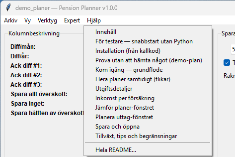

## Kom igång — grundflöde

### 1. Hämta en plan från minpension.se

**Alternativ A — automatiskt (rekommenderat):**
- Verktyg → **Hämta från minpension.se...**
- Chrome öppnas och du guidas genom inloggning
- Planen läses in automatiskt

**Så går hämtningen till — fönstret "Hämta från minpension.se":**

Fönstret leder dig genom fyra steg. Du klickar på knappen nere till
vänster för att gå vidare, och **Avbryt** stänger fönstret när som helst.

1. **Starta Chrome.** Klicka **Starta Chrome**. Ett separat Chrome-fönster
   öppnas med minpension.se. Är ett sådant Chrome-fönster redan öppet
   sedan tidigare hoppas detta steg över och den inloggningen återanvänds.
   Första gången startar Chrome med en tom profil och frågar om du vill
   logga in i Chrome med ett Google-konto. Det behöver du inte — välj att
   fortsätta utan att logga in. Därefter ber Chrome dig välja sökmotor
   för att komma vidare. Välj **Google** och klicka **Ange som standard**,
   så öppnas inloggningssidan på minpension.se.
2. **Logga in på minpension.se och välj plan.** Logga in på minpension.se
   i Chrome-fönstret, t.ex. med BankID. Det är den inloggningen som avses,
   inte inloggning i Chrome med ett Google-konto. Efter
   inloggningen hamnar du på sidan **Dina planer**. Gå tillbaka till appen
   och klicka **Klar med inloggning** (eller **Fortsätt** om inloggningen
   återanvänds). Appen listar då dina sparade uttagsplaner. Skriv i
   **Sök plan** för att filtrera listan, markera en plan och klicka
   **Hämta vald plan**. Dubbelklick eller Enter väljer också.
3. **Hämtar data.** Appen öppnar planen i Chrome, expanderar raderna
   Privat pension, Tjänstepension och Allmän pension och läser av sidan.
   Du behöver inte göra något i detta steg.
4. **Granska och använd.** En sammanfattning visar planens namn, antal
   brytpunkter, om inkomst per försäkring kom med och alla försäkringar
   med start och längd. Knappen lägger in planen i appen. Den heter
   **Använd → Ny flik** för en ny plan, **Använd → Ersätt befintlig** när
   en plan med samma namn redan är öppen och **Använd → Lägg till i tom
   flik** när ingen plan är inläst.

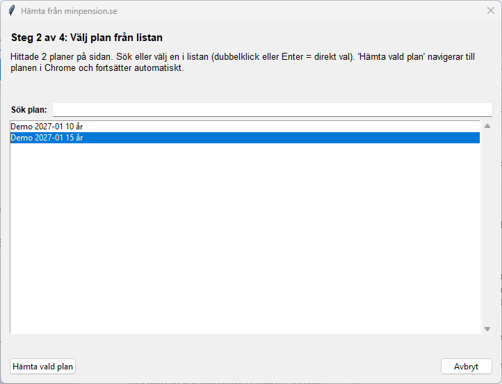

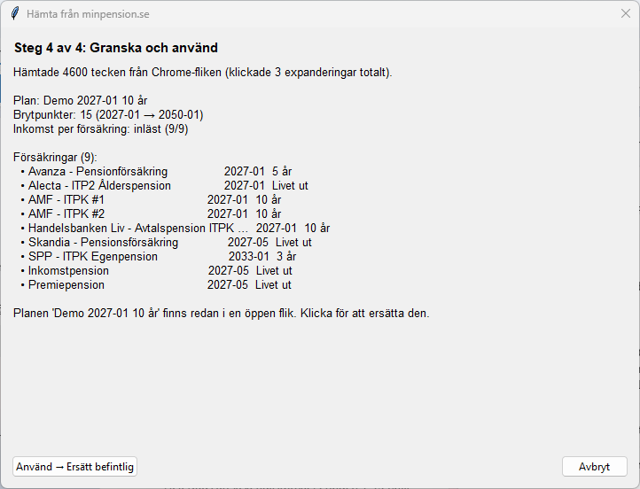

Vill du hämta flera planer öppnar du fönstret igen för varje plan. Så
länge Chrome-fönstret är öppet och du är inloggad behöver du inte logga
in på nytt. Står Chrome redan på en enskild uttagsplan när du klickar
vidare i steg 2 hämtas den planen direkt, utan listan. Hittar appen
varken en plan eller planlistan får du ett meddelande om att gå till
rätt sida i Chrome och försöka igen.

> **Inloggningen sköts helt av minpension.se.** Appen har ingen kontroll
> över inloggningen. Du loggar
> in själv i Chrome-fönstret med den metod du väljer på minpension.se,
> t.ex. BankID. Det måste du göra en gång innan du kan hämta dina planer,
> och sedan på nytt varje gång du har stängt Chrome-fönstret eller blivit
> utloggad på grund av inaktivitet.

> **Första gången du kör Hämta:** Chrome startar med en **egen tom
> profil** i en dold mapp (`.chrome_minpension/`) bredvid appen. Det
> gör att Chrome beter sig som vid en nyinstallation — du får frågor
> om välkomstflöde, val av sökmotor, inloggning m.m. Klicka bara
> igenom (du behöver inte logga in på ett Google-konto, hoppa över
> allt utom minpension.se-inloggningen). Nästa gång är profilen
> ihågkommen och Chrome startar direkt.
>
> Anledningen till den separata profilen: appen behöver kontrollera
> Chrome via en debug-port utan att störa dina vanliga bokmärken,
> flikar eller inloggningar i din primära Chrome. Profilmappen är
> lokal och skickas inte någonstans.

**Alternativ B — manuellt:**
- Logga in på minpension.se, öppna en uttagsplan
- Expandera raderna **Privat pension**, **Tjänstepension** och **Allmän
  pension** på sidan innan du kopierar, så att beloppen per försäkring
  syns. Annars fungerar inte **Inkomst per försäkring** som tänkt.
  (Med Alternativ A görs detta automatiskt.)
- Markera allt (`Ctrl+A`) och kopiera (`Ctrl+C`)
- Välj **Verktyg → Klistra in kopierad text från minpension.se...**, klistra
  in texten (`Ctrl+V`) och klicka **Spara** — planen läggs i en ny flik
- Finns redan en plan med samma namn får du välja **Skriv över**,
  **Lägg in som ny plan** (namnet får tillägget `#2`, `#3`, …) eller **Avbryt**

### 2. Ange dina uppgifter
- **Sparande**: hur mycket du har som buffert vid pensionens början
- **Utgiftsbrytpunkter**: månadsutgift per ålder (t.ex. 27 000 kr/mån upp
  till 70 år, 25 000 upp till 80 år, …). Fem olika **utgifts-set** (Set 1-5)
  kan användas för olika scenarios.
- **Tillväxt** (valfri): procent avkastning på sparandet (real, efter
  inflation)
- **Räkna till ålder**: simuleringen räknar till och med året du fyller
  denna ålder (70–110, normalt 90). Värdet sparas i planfilen.

### 3. Läs av resultatet

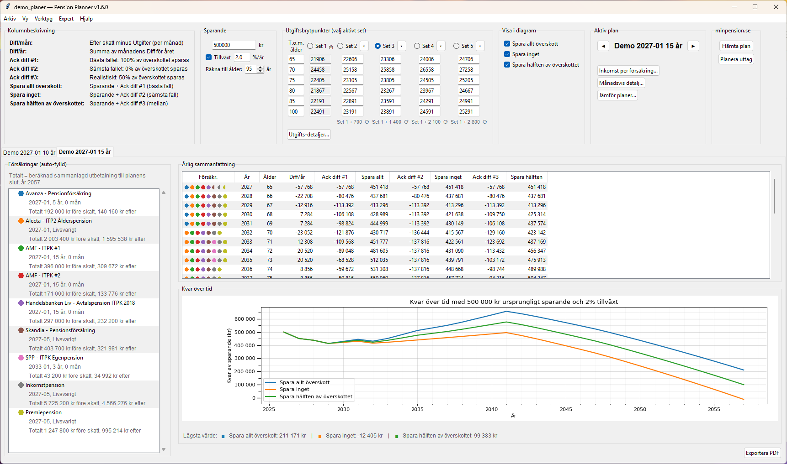

- **Diagram** (nere till höger): hur sparandet utvecklas över tid enligt tre olika
  kvar-strategier
- **Årstabell** (uppe till höger): år-för-år-siffror
- **Månadsvis detalj** (eget fönster, knappen **Månadsvis detalj...** under
  *Aktiv plan*): inkomst före/efter skatt, utgifter och diff månad för månad.
  Fönstret följer den aktiva plan-fliken.
- **Försäkringar** (vänster): färgkodad lista med start och längd
- **Globala inställningar** (uppe): sparande, tillväxt, utgiftsbrytpunkter

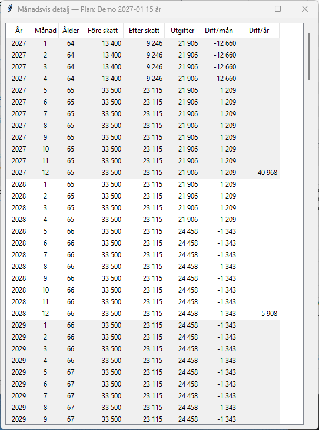

### Kvar-strategier
- **Kvar #1 "Spara allt"**: hela överskottet läggs till sparandet
- **Kvar #2 "Spara hälften"**: hälften av överskottet sparas, hälften används
- **Kvar #3 "Spara inget"**: allt överskott konsumeras

## Flera planer samtidigt (flikar)

- Flera planer från minpension.se kan hämtas in. Varje plan representeras
  då som en ny flik som kan visas för sig själv eller jämföras med andra
  planer/flikar.
- Varje flik = en uttagsplan (t.ex. olika starter eller längder)
- Globala inställningar (sparande, brytpunkter) delas mellan flikarna
- Dra flikarna för att sortera; högerklicka → Stäng plan

## Utgiftsdetaljer

Vy → **Utgifts-detaljer...**

En detaljerad kalkyl av dina förväntade månadsutgifter, uppdelad i
kategorier och enskilda utgiftsposter. Summan uppdaterar automatiskt
**Set 1** i utgiftsbrytpunkterna, så att beräkningarna av kvar-linjer
och månadsinkomst reflekterar vad du faktiskt tror att livet kommer att
kosta år för år.

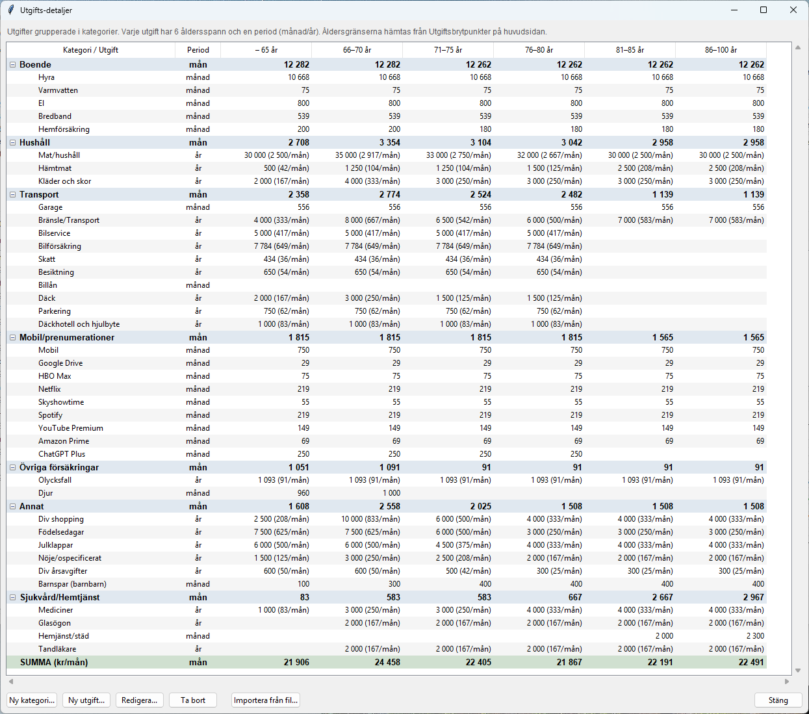

### Struktur
- **Kategorier** (t.ex. "Bostad", "Mat och hushåll", "Bil", "Resor",
  "Hälsa", "Hobby", "Övrigt")
- Under varje kategori: **enskilda utgifter** med belopp per åldersintervall
- Belopp är kr/mån, angivna för respektive brytpunkts-ålder (t.ex. 65,
  70, 75, 80, 85, 100)
- Summan av alla utgifter per åldersintervall → Set 1

### Använd
- **Lägg till kategori/utgift**: knappar underst i fönstret
- **Redigera belopp**: dubbelklicka på en cell
- **Ta bort**: markera rad → knappen "Ta bort"
- **Importera från fil**: kopiera utgiftskategorier från en annan
  plan-JSON (t.ex. en delad demo eller egen tidigare fil)

### Praktiskt tips
Utgifter varierar oftast med åldern. Bra riktlinje:
- **63-72 år** (aktiv pension): högst utgifter — resor, hobby,
  underhåll, renoveringar
- **72-80 år**: medel — mindre resor, mer hem
- **80+ år**: lägre — mindre aktivitet, kan behövas hjälpmedel
- Enskilda poster som **bolån** kan sluta helt vid en viss ålder — sätt
  0 för åldrarna där de inte längre gäller

Set 2-5 kan sättas manuellt eller via härledningsregler (t.ex. "Set 2 = Set 1
+ 5 %" som en pessimistisk variant för "vad om utgifterna blir högre").

## Inkomst per försäkring

Vy → **Inkomst per försäkring...**

Ett detaljfönster som visar exakt vilka försäkringar som betalar ut hur
mycket vid varje ålder i den **aktiva planen**, tillsammans med en
visuell tidslinje och månadsinkomst-jämförelse mot utgifter. Bra för att
förstå VARFÖR sparande-grafen ser ut som den gör.

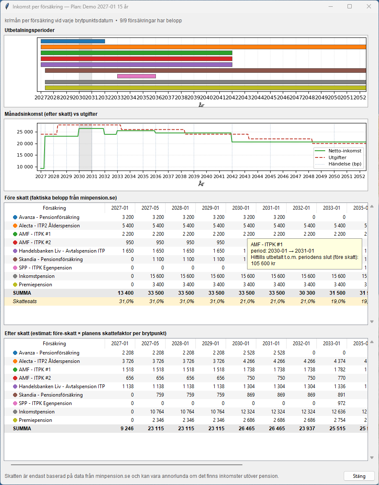

### Vad du ser

Fönstret har fyra sektioner staplade från topp till botten (alla med
alignade x-axlar mellan tidslinjerna):

- **Utbetalningsperioder** (Gantt) — en horisontell stapel per försäkring
  som visar när utbetalningen startar och slutar. Livet ut-försäkringar
  får en `→`-pil vid slutet.
- **Månadsinkomst (efter skatt) vs utgifter** — linjegraf över netto-inkomst
  (grön) och utgifter (röd streckad) månad för månad. Diskreta prickade
  vertikala linjer markerar varje brytpunkt (bp) — där en försäkring
  startar/slutar eller skattesatsen ändras.
- **Före skatt-tabell** — faktiska belopp från minpension.se, rader =
  försäkringar, kolumner = brytpunkter (t.ex. 2027-01, 2027-05, ...),
  plus SUMMA-rad och Skattesats-rad.
- **Efter skatt-tabell** — samma matris med före-belopp × per-brytpunkts-
  skattefaktor.

### Interaktioner

- **Hover över Gantt-stapel** — popup med år-månad, ålder, försäkringens
  namn/start/längd och status vid det datumet (Ej startad / Pågående /
  Avslutad).
- **Hover över månadsinkomst-graf** — popup med år-månad, ålder, netto,
  utgifter och diff för hovrad månad.
- **Hover över en cell i tabellerna** — samma popup som förut (kumulativ
  utbetalning t.o.m. periodens slut) OCH en **ljusgrå bakgrund** ritas
  över motsvarande period i både Gantt och månadsinkomst-grafen, så du
  ser exakt vilken tidsperiod cellen representerar.

### Praktiskt tips
- Om en försäkring visar 0 kr i en kolumn betyder det att den inte
  utbetalar under den perioden (antingen ej startad eller redan slut)
- Byt aktiv plan i huvudfliken → hela fönstret uppdateras automatiskt
- Byt utgifts-set (Set 1-5) i huvudfliken → utgifts-linjen i
  månadsinkomst-grafen följer med

## Jämför planer-fönstret

Vy → **Jämför planer...** eller knappen **Jämför planer...** under
*Aktiv plan*.

Överlappar Kvar-linjer från flera planer i en graf så du kan se vilken
som ger bäst resultat.

**Fem flikar:**

**Graf** — kvar-linjer överlagrade, hover för värden per plan (visar
vilken som är högst/lägst för respektive kvar-strategi):

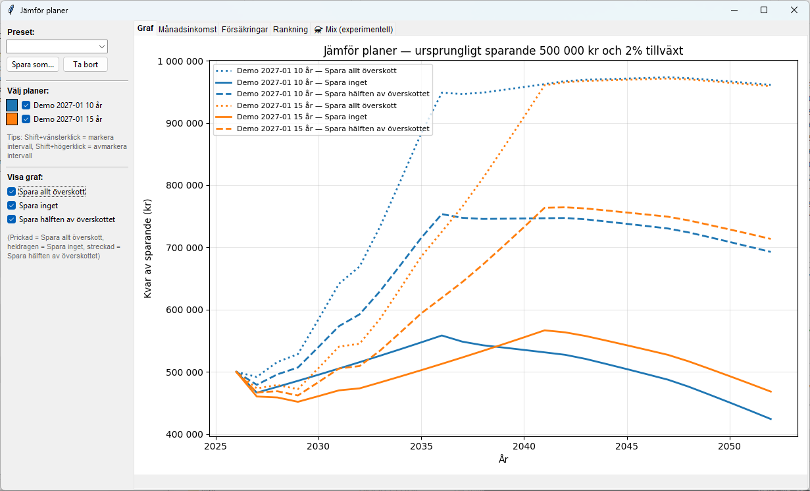

**Månadsinkomst** — månadsbelopp per plan över tid, med utgifts-linje.
Hover visar per-försäkring-belopp för aktiva planer:

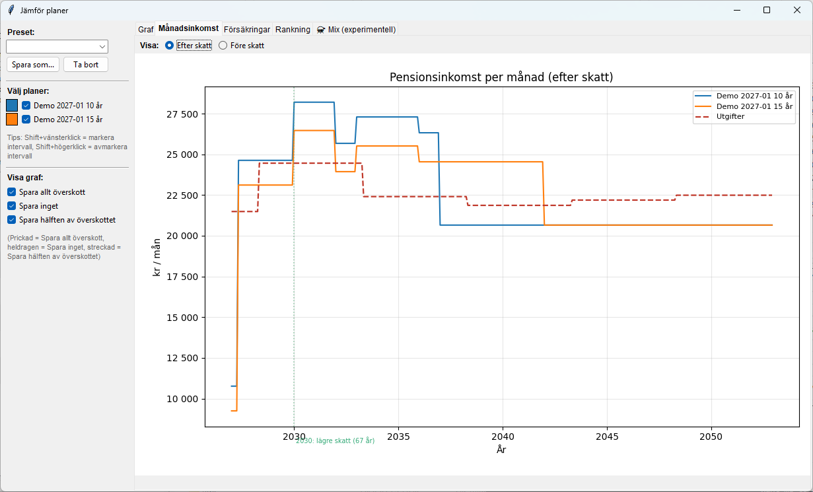

**Försäkringar** — matris över alla försäkringar × alla planer med
färgkodning.

**Rankning** — sortera planer efter slutvärde/lägsta/total, välj kvar-
strategi och slutår:

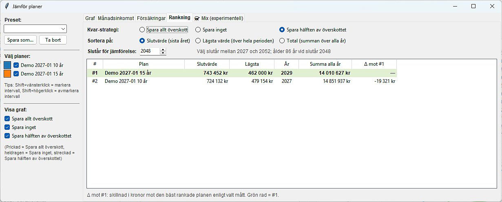

**Mix (experimentell)** — hitta bästa kombination av per-försäkrings-configs
från flera planer i samma familj (t.ex. alla "2027-01"-planer). Visar
approximationens felmarginal via self-test:

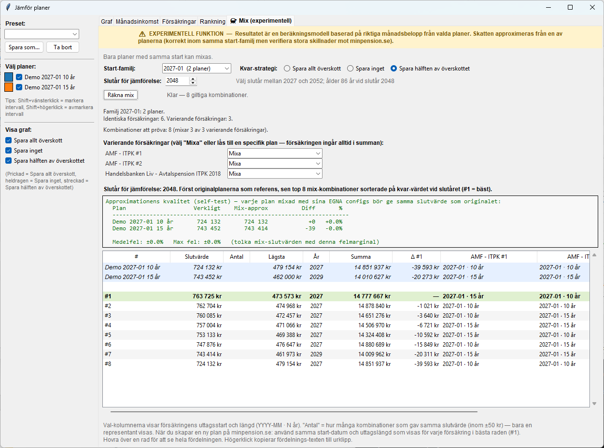

När du hittat en lovande mix-kombination: **skapa den uttagsplanen på
minpension.se** (kopiera per-försäkrings-start/längd från Mix-tabellen)
och **hämta hem den** för korrekta utbetalningsnivåer. Mix-siffrorna är
approximation ovanpå approximation (per-försäkrings-belopp från olika
källor summeras), så verifiering här är extra viktig.

**Praktiskt tips**: högerklicka på en plan-checkbox → "Ta bort" för
icke-hämtade planer (SIM/MAN eller manuellt inklistrade).

## Planera uttag-fönstret

Verktyg → **🎯 Planera uttag (Föreslå/Manuellt)...** eller **Planera uttag**-
knappen i minpension.se-rutan.

Kräver minst en hämtad plan som **utgångsplan**.

Två flikar för att skapa nya uttagsplaner:

### Föreslå (automatisk)

Greedy-optimering som söker bästa (start, längd) per försäkring.

**Inställningar:**
- **Utgångsplan**: vilken hämtad plan som utgörs för approximation
- **Allmän pension tidigast**: när Inkomst-/Premiepension får starta
  (typiskt riktålder − 3 år)
- **Kvar-strategi**: vilken av #1/#2/#3 som optimeringen räknar på
- **Optimera för**:
  - *Slutvärde*: högsta slutkapital (skjuter oftast uttag framåt)
  - *Lägsta värde*: jämnaste sparande-linje (undviker dippar)
  - *Total*: mellanvariant
  - *Matcha utgifter*: minimerar månatliga underskott (rekommenderat om
    din prioritet är att sparandet räcker under aktiva pensionsåren)
  - *Balanserad*: blandar match + slutvärde via **Balans**-slidern (0-100)
- **Min sparande**: hårdvarudgräns — förkasta configs där sparandet någon
  gång går under
- **Slutår**: horisont för optimering
- **Lås försäkringar**: kryssa försäkringar som ska behålla sina
  originalvärden (Alecta ITP2 är ofta obligatoriskt Livet ut, låser
  du den så optimeraren inte ändrar den)

**Använd:**
1. Välj utgångsplan
2. Lås försäkringar som inte kan ändras (klicka "Lås Livet ut" +
   "Lås allmän pension")
3. Välj mål (typiskt "Matcha utgifter" eller "Balanserad")
4. Klicka **Föreslå plan**
5. Se resultatet i tabellen + graf
6. Klicka **Skapa som plan-flik i huvudfönstret** för att spara som
   `SIM_FROM_<utgångsplan>`
7. **Verifiera på minpension.se**: skapa samma uttagsplan där (samma
   start och längd per försäkring) och hämta hem den. Utbetalningsnivåerna
   från minpension är de korrekta — appens siffror är en approximation.

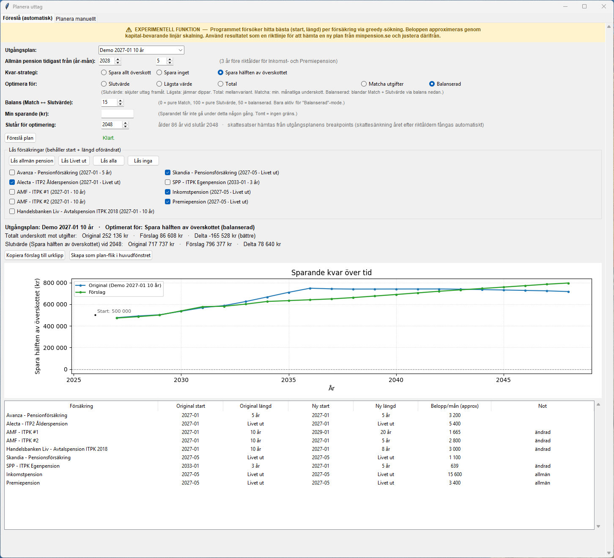

### Planera manuellt

Interaktiv redigering av varje försäkrings start och längd med direkt
visuell återkoppling.

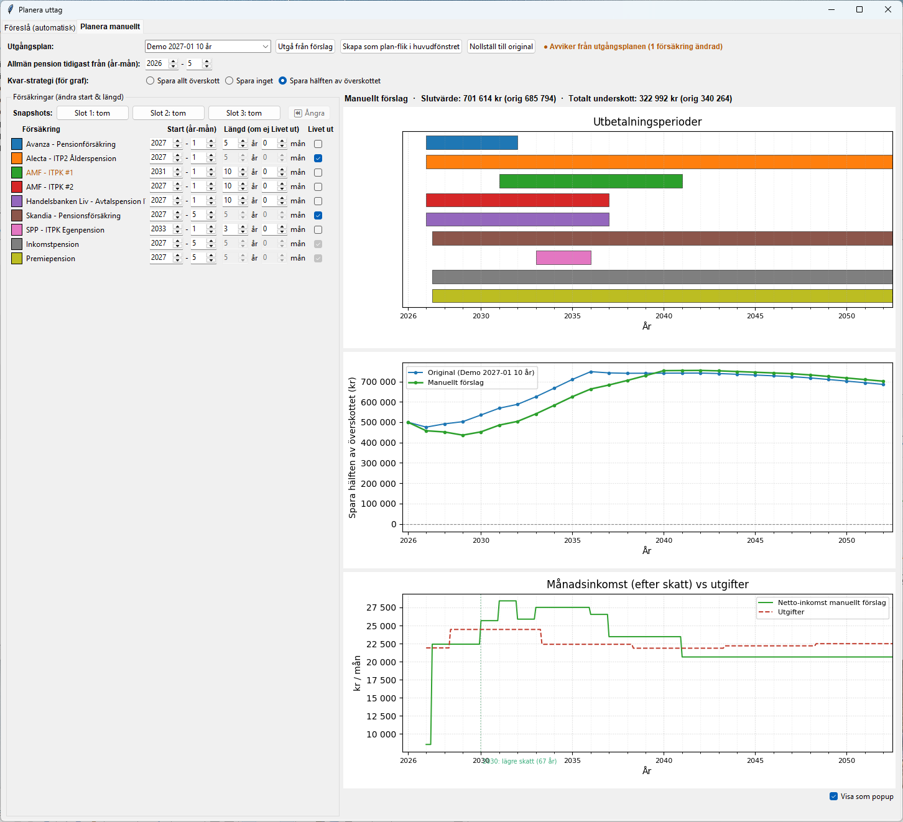

**Layout:**
- **Vänster**: försäkringstabell — färgruta + namn + start-år/månad +
  längd-år/månad + Livet ut-checkbox per försäkring
- **Snapshot-rad**: tre slots för att spara/återställa configs + ⏪ Ångra
- **Höger, tre grafer** (alignade x-axlar):
  1. **Gantt** — utbetalningsperioder som horisontella staplar
  2. **Kvar** — sparande över tid (original vs manuellt förslag)
  3. **Månadsinkomst vs utgifter** — netto per månad + utgifts-linje

**Interaktion:**
- Ändra spinbox-värden → alla grafer uppdateras direkt
- **Vänsterklick** på Gantt-stapel → fokuserar motsvarande spinbox-rad
- **Högerklick** på Gantt-stapel → meny för snabb-fokus + toggle Livet ut
- **Hover** över grafer visar år-månad + ålder + kontextinfo
  (försäkringsnamn på Gantt, kvar-värde på Kvar, netto − utgift på
  Månadsinkomst)
- Checkbox **Visa som popup** → flytande tooltip vid musen

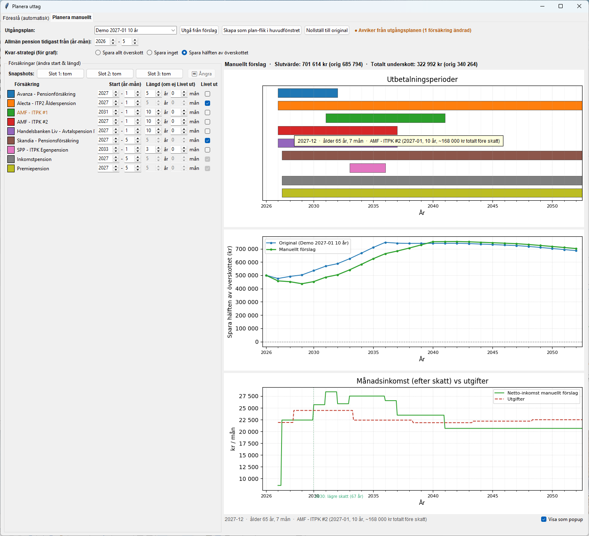

**Snapshot-slots** (upp till 3):
- Klick på tom slot → sparar aktuell config
- Klick på fylld slot → meny (Återställ / Skriv över / Rensa)
- **⏪ Ångra**: återställ senaste config före en Återställ-operation

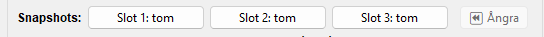

**Utgå från förslag**-knappen kopierar senaste Föreslå-körningens configs
till manuellt-fliken så du kan finjustera från optimeringens utgångspunkt.
Knappen är inaktiv tills du har kört **Föreslå plan** i den andra fliken.

**Nollställ till original** återställer alla försäkringar till
utgångsplanens start och längd. Raderna du senast hade sparas per
utgångsplan och läggs tillbaka nästa gång fönstret öppnas. När de skiljer
sig från utgångsplanen visas texten **Avviker från utgångsplanen** bredvid
knappen och de ändrade försäkringarnas namn färgas orange. Knappen är
inaktiv när inget avviker.

**Skapa som plan-flik i huvudfönstret** → sparar som `MAN_FROM_<utgångsplan>`
i huvudappen så du kan jämföra i grafen. Knappen är inaktiv när inget
avviker från utgångsplanen, eftersom den planen redan finns som flik.

När du väl bestämt dig för en manuell config: **skapa samma uttagsplan på
minpension.se** (samma start och längd per försäkring) och **hämta hem
den**. Bara då får du korrekta utbetalningsnivåer — appens tal är
approximerade.

### Rekommenderat arbetssätt

1. Hämta 5-10 planer från minpension med olika configs
2. Kör **Föreslå** med "Matcha utgifter" eller "Balanserad" som mål
3. Klicka **Utgå från förslag** i manuellt-fliken
4. Finjustera med spinboxarna, använd snapshots för att spara alternativ
5. **Skapa som plan-flik** → sparar för jämförelse
6. **Skapa motsvarande plan på minpension.se** och hämta den — verifiera
   att verkligheten stämmer med approximationen (typiskt 5-10% fel)

## Spara och öppna

Alla planer + inställningar sparas i en JSON-fil via Arkiv-menyn:
- **Öppna...** — läs in sparad fil
- **Spara** — nuvarande fil (frågar om filnamn om ingen är öppen)
- **Spara som...** — nytt filnamn
- **Ångra stängning** (Ctrl+Shift+T) — återupprätta senast stängda plan

Sparade planer inkluderar hämtade och genererade (`SIM_FROM_*`,
`MAN_FROM_*`). Senaste öppnade fil laddas automatiskt vid nästa start.

## Tillväxt, tips och begränsningar

### Tillväxt
- **Sparande-tillväxt**: ränta på sparandet, procent per år, sammansätts
  månadsvis. Tolka som **real** avkastning (efter inflation) — inte
  nominell. Poängen är att alla belopp i graferna då visas i **dagens
  penningvärde** så att sparande och utgifter är direkt jämförbara med
  vad kronorna är värda nu.
- Ange därför något i storleksordningen **2–4 %** (real avkastning efter
  att inflation dragits bort från börsens nominella 7–10 %). Sätter du
  in 5–10 % så visar kurvan uppblåsta framtida kronor som är svårare
  att relatera till dagens utgifter — det är alltså **inte** samma sak
  som "börsen har gett 8 %".
- **Kapital-tillväxt inne i försäkringar**: appen använder utgångsplanens
  belopp direkt för oförändrade försäkringar; för ändrade approximerar
  vi med kapital-bevarande formel + tillväxt-uppräkning vid uppskjuten
  start.

Se [BERAKNINGAR.md](BERAKNINGAR.md) för exakta formler.

### Skattesänkningen året efter riktåldern
Skatten på pension sänks kraftigt från 1 januari **året efter du fyllt
riktåldern** (förhöjt grundavdrag: ~32 % → ~20 %). Konkret exempel:

| Din riktålder | Skattesänkning från |
|---|---|
| 67 år | året du fyller 68 |
| 68 år | året du fyller 69 |
| 69 år | året du fyller 70 |
| 70 år | året du fyller 71 |

Utgångsplanens breakpoints fångar detta automatiskt eftersom
minpension.se redan har rätt skattesats per datum, så både grafer och
optimering använder rätt sats per ålder utan att du behöver ange något.

### Approximation-felmarginal
För ändrade försäkringar i Föreslå/Manuellt: månadsbeloppet beräknas via
enkel kapital-fördelning, medan minpension räknar aktuariellt. Fel är
typiskt 5-10 % för normalt förändrade planer, ibland större för stora
förändringar (Livet ut → fast dur kan underskatta månadsbeloppet 2-3x).
Verifiera alltid slutförslag mot en riktig plan från minpension.

### Bygg som .exe (för delning utan Python)
```powershell
pip install pyinstaller
python build.py
```
Resultat: `dist/pensionsplanerare.zip` (~50 MB) — en zippad mapp med
`pension_planner.exe`, support-filer, README/BERAKNINGAR, screenshots
och `demo_planer.json`. Kan laddas upp direkt till GitHub Releases.

Bygget använder `--onedir`-läge (mapp-distribution) för att undvika
Windows Defender false-positive-varningar som `--onefile` triggar.

### Dela dokument
JSON-filen innehåller alla planer och globala inställningar (sparande,
brytpunkter, utgiftskategorier). Mottagaren kan öppna filen direkt utan
egen minpension-inloggning för att analysera dina planer.
